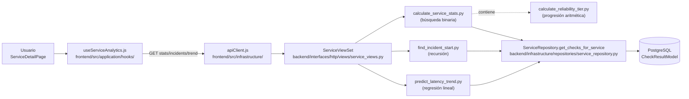
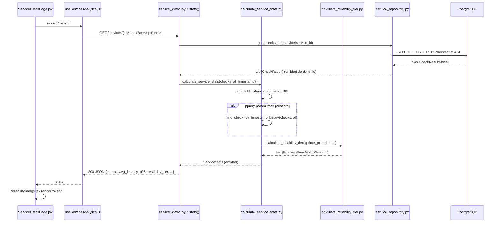
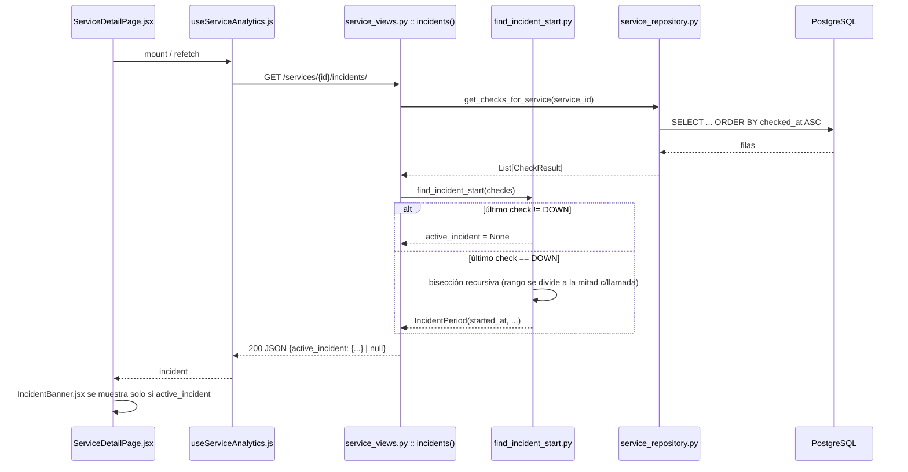
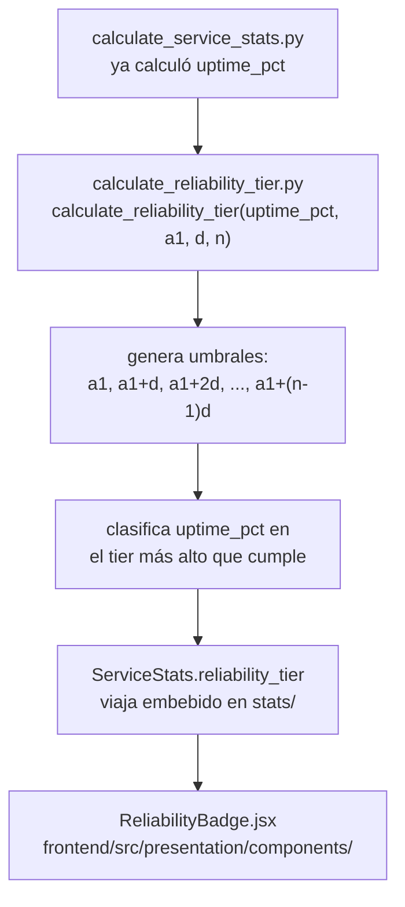
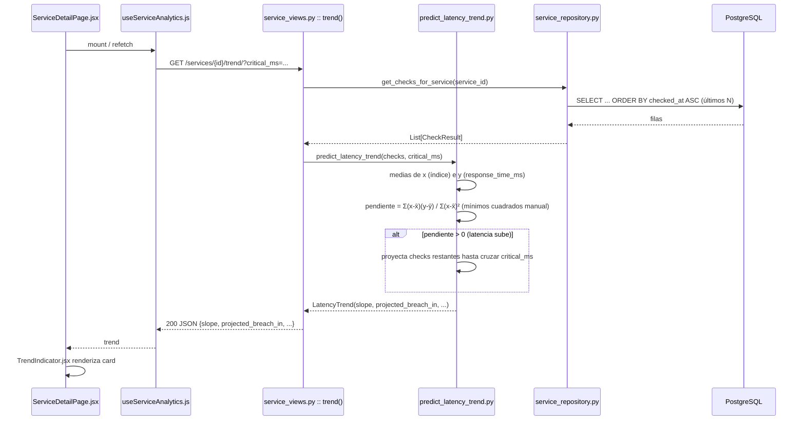
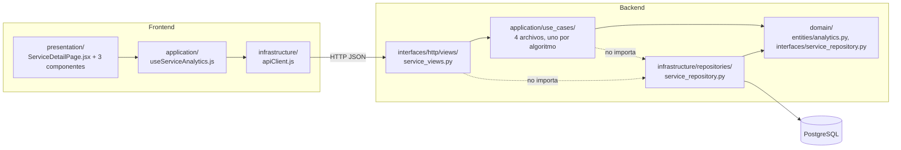

# Flujo de los algoritmos aplicados en Sentinel

Complementa `docs/ALGORITMOS_APLICADOS.md` (qué y por qué) y `docs/PLAN_ALGORITMOS.md` (plan). Este documento traza el **flujo completo request → response** de cada algoritmo: desde el click en el frontend hasta el cálculo puro en `application/use_cases/`, con archivo y ruta exacta en cada salto.

---

## Vista general — las 4 rutas comparten el mismo punto de entrada

Los 3 endpoints se piden en paralelo (`Promise.all`) desde un único hook, pero cada uno resuelve un algoritmo distinto en el backend. El tier (algoritmo 3) no tiene endpoint propio: viaja embebido en la respuesta de `stats/`.

---

## 1. Búsqueda binaria vs lineal + estadísticas

**Disparador:** carga de `ServiceDetailPage.jsx` → `useServiceAnalytics(id)` → `GET /api/v1/services/{id}/stats/`

**Archivos y rutas:**
- `frontend/src/presentation/pages/ServiceDetailPage.jsx`
- `frontend/src/application/hooks/useServiceAnalytics.js`
- `frontend/src/presentation/components/ReliabilityBadge.jsx`
- `backend/interfaces/http/views/service_views.py` → método `stats`
- `backend/application/use_cases/calculate_service_stats.py` → `calculate_service_stats`, `find_check_by_timestamp_binary`, `find_check_by_timestamp_linear` (referencia comparativa, solo test)
- `backend/application/use_cases/calculate_reliability_tier.py` (invocado desde adentro de este caso de uso)
- `backend/domain/interfaces/service_repository.py` → contrato `get_checks_for_service`
- `backend/infrastructure/repositories/service_repository.py` → implementación real
- `backend/domain/entities/analytics.py` → entidad `ServiceStats`
- Test: `backend/tests/unit/test_calculate_service_stats.py`

---

## 2. Recursión (bisección) — inicio de incidente

**Disparador:** mismo mount de `ServiceDetailPage.jsx` → `GET /api/v1/services/{id}/incidents/`

**Archivos y rutas:**
- `backend/interfaces/http/views/service_views.py` → método `incidents`
- `backend/application/use_cases/find_incident_start.py` (recursivo, caso base + reducción de rango)
- `backend/domain/entities/analytics.py` → entidad `IncidentPeriod`
- `frontend/src/presentation/components/IncidentBanner.jsx`
- Test: `backend/tests/unit/test_find_incident_start.py` (incluye `test_operations_count_is_logarithmic`)

**Precondición:** racha `DOWN` continua hasta el último check (sin altibajos intermedios) — ver límite documentado en `docs/PRUEBA_ALGORITMOS.md` punto 2.

---

## 3. Progresión aritmética — tiers de confiabilidad

No tiene endpoint propio: se calcula **dentro** del flujo del algoritmo 1, como último paso antes de responder `stats/`.

**Archivos y rutas:**
- `backend/application/use_cases/calculate_reliability_tier.py` — `a1`, `d`, `n` siempre parámetros de función, nunca hardcodeados
- Invocado desde `backend/application/use_cases/calculate_service_stats.py`
- Campo de salida: `ServiceStats.reliability_tier` en `backend/domain/entities/analytics.py`
- `frontend/src/presentation/components/ReliabilityBadge.jsx`

---

## 4. Regresión lineal — predicción de degradación

**Disparador:** mismo mount de `ServiceDetailPage.jsx` → `GET /api/v1/services/{id}/trend/?critical_ms=<umbral>`

**Archivos y rutas:**
- `backend/interfaces/http/views/service_views.py` → método `trend`
- `backend/application/use_cases/predict_latency_trend.py`
- `backend/domain/entities/analytics.py` → entidad `LatencyTrend`
- `frontend/src/presentation/components/TrendIndicator.jsx`

---

## Capas atravesadas (Clean Architecture, dirección hacia adentro)

`application/` depende solo de `domain/` (interfaces, nunca de la implementación en `infrastructure/`). La instancia concreta del repositorio se inyecta en `interfaces/http/views/service_views.py`, no dentro de los casos de uso.

---

## Resumen archivo por archivo

| Capa | Archivo | Rol |
|---|---|---|
| Frontend presentación | `frontend/src/presentation/pages/ServiceDetailPage.jsx` | integra los 3 componentes |
| Frontend presentación | `frontend/src/presentation/components/ReliabilityBadge.jsx` | algoritmo 3 |
| Frontend presentación | `frontend/src/presentation/components/IncidentBanner.jsx` | algoritmo 2 |
| Frontend presentación | `frontend/src/presentation/components/TrendIndicator.jsx` | algoritmo 4 |
| Frontend aplicación | `frontend/src/application/hooks/useServiceAnalytics.js` | fetch paralelo de los 3 endpoints |
| Frontend infraestructura | `frontend/src/infrastructure/apiClient.js` | cliente HTTP |
| Backend interfaces | `backend/interfaces/http/views/service_views.py` | endpoints `stats`, `incidents`, `trend` (`@action` sobre `ServiceViewSet`) |
| Backend aplicación | `backend/application/use_cases/calculate_service_stats.py` | algoritmo 1 (búsqueda binaria/lineal + estadísticas) |
| Backend aplicación | `backend/application/use_cases/find_incident_start.py` | algoritmo 2 (recursión/bisección) |
| Backend aplicación | `backend/application/use_cases/calculate_reliability_tier.py` | algoritmo 3 (progresión aritmética) |
| Backend aplicación | `backend/application/use_cases/predict_latency_trend.py` | algoritmo 4 (regresión lineal) |
| Backend dominio | `backend/domain/entities/analytics.py` | `ServiceStats`, `IncidentPeriod`, `LatencyTrend` |
| Backend dominio | `backend/domain/interfaces/service_repository.py` | contrato `get_checks_for_service` |
| Backend infraestructura | `backend/infrastructure/repositories/service_repository.py` | implementación del repositorio + `_to_check_result_entity` |
| Tests | `backend/tests/unit/test_calculate_service_stats.py` | valida algoritmo 1 |
| Tests | `backend/tests/unit/test_find_incident_start.py` | valida algoritmo 2 (`test_operations_count_is_logarithmic`) |

Ver `docs/ALGORITMOS_APLICADOS.md` para complejidad Big O de cada uno y `docs/PRUEBA_ALGORITMOS.md` para flujo de prueba manual paso a paso.
